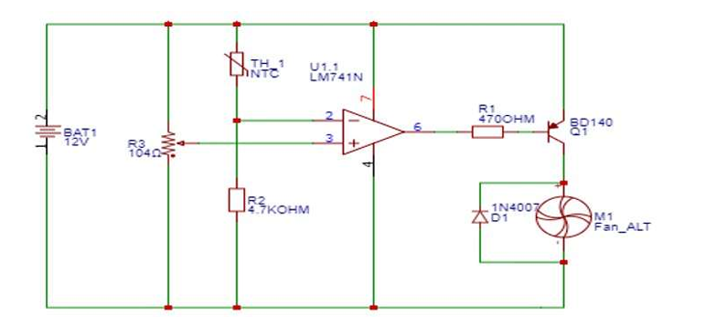
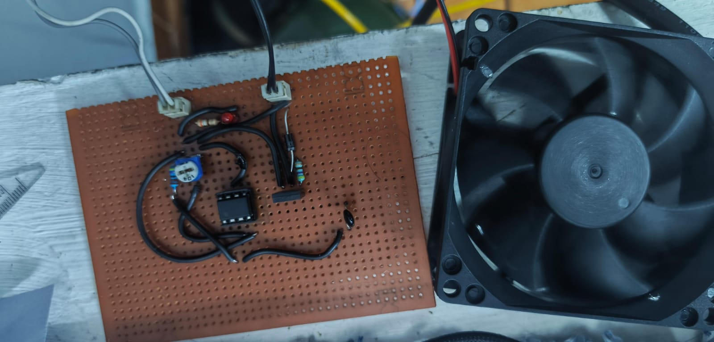
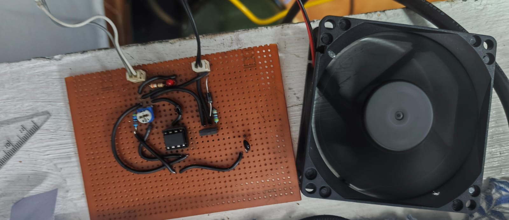
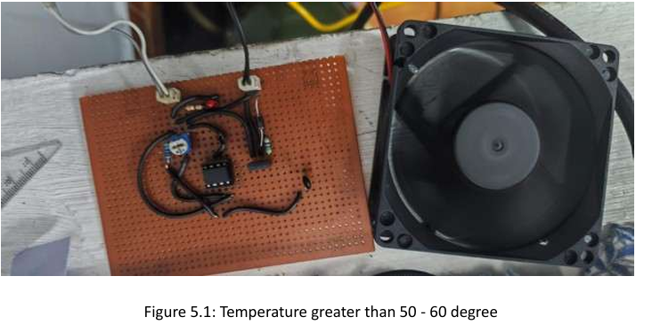

# Temperature Controlled DC Fan using LM741 Op-Amp

An analog thermal-management circuit that switches a DC fan ON only when the temperature crosses a preset threshold. An NTC thermistor senses temperature, an LM741 op-amp acts as a comparator, and a transistor drives the fan. No microcontroller needed.

## How it works

1. **Sensing:** a 10k NTC thermistor and a 4.7k resistor (R2) form a voltage divider. As temperature rises, the thermistor resistance falls and the divider voltage rises.
2. **Comparison:** the divider voltage goes to the inverting input (pin 2) of the LM741. A 10k potentiometer (R3) sets the reference voltage at the non-inverting input (pin 3), which is the temperature threshold.
3. **Driving:** the op-amp output (pin 6) goes through a 470 ohm base resistor (R1) to the BD140 transistor, which switches the fan.
4. **Protection:** a 1N4007 diode across the fan absorbs back-EMF spikes when the fan turns off.

Below the threshold the fan stays OFF; above it the fan runs automatically. Adjust the potentiometer to move the switching point.

## Components

| Part | Value / Type |
|---|---|
| Op-amp | LM741 |
| Temperature sensor | NTC thermistor, 10k |
| R2 | 4.7k |
| R1 (base resistor) | 470 ohm |
| R3 (threshold pot) | 10k variable resistor |
| Transistor | BD140 (PNP), as drawn in the schematic |
| Flyback diode | 1N4007 |
| Fan | DC fan (12 V as built) |
| Supply | 12 V |
| Indicator | Power LED with series resistor |

## Build

Designed and tested on a breadboard first, then built on a general-purpose (perf) PCB.

| | |
|---|---|
|  |  |

## Results

- Fan starts when the sensed temperature exceeds the preset threshold (about 40 to 60 °C in testing).
- Fan stays OFF below the threshold.
- Power LED stays ON while the circuit is powered.
- Threshold is adjustable with the potentiometer.

## SDGs addressed

SDG 7 (Affordable and Clean Energy), SDG 9 (Industry, Innovation and Infrastructure), SDG 11 (Sustainable Cities and Communities), SDG 12 (Responsible Consumption and Production), SDG 13 (Climate Action).

## Documentation

Full project report: [docs/project_report.md](docs/project_report.md)

## Author

Adil M M, B.Tech VLSI Design & Technology, Saintgits College of Engineering, Kottayam
